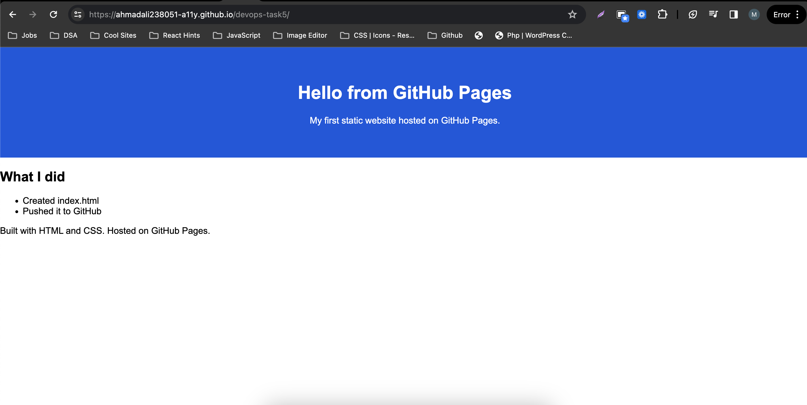

# Task 6: Host a Static Website with GitHub Pages

DevOps Internship, Elevate Labs

## Objective
Deploy a simple HTML website using GitHub Pages.

## Tools Used
- HTML and CSS
- Git and GitHub
- GitHub Pages
- VS Code

## Live Website
https://ahmadali238051-a11y.github.io/devops-task5/

> If you rename the repo or create a new one, update this link to match.

## Screenshot


## Files in This Repository
| File | Description |
|---|---|
| `index.html` | The web page (the default file GitHub Pages loads) |
| `style.css` | CSS styling for the page |
| `screenshot.png` | Screenshot of the live website |
| `README.md` | This file |

## Steps I Followed
1. Created `index.html` with a header, a main section containing a bullet list, and a footer.
2. Created `style.css` and linked it in the `<head>` of `index.html` using `<link rel="stylesheet" href="style.css">`.
3. Created a new public repository on GitHub.
4. Pushed the files to the repository:
   ```bash
   git init
   git add .
   git commit -m "Add static website"
   git branch -M main
   git remote add origin https://github.com/<username>/<repo-name>.git
   git push -u origin main
   ```
5. Opened the repository, then **Settings**, then **Pages**.
6. Under **Build and deployment**, selected **Deploy from a branch**, then the `main` branch and the `/ (root)` folder, and clicked **Save**.
7. Waited for the deployment in the **Actions** tab to finish, then opened the live link that GitHub provided.
8. Customized the page with CSS (a blue header banner with centered white text).
9. Updated the site by committing and pushing the CSS change:
   ```bash
   git add .
   git commit -m "Style the header with CSS"
   git push
   ```

## Outcome
I deployed a static website for free and learned how to update it by pushing changes to GitHub.

